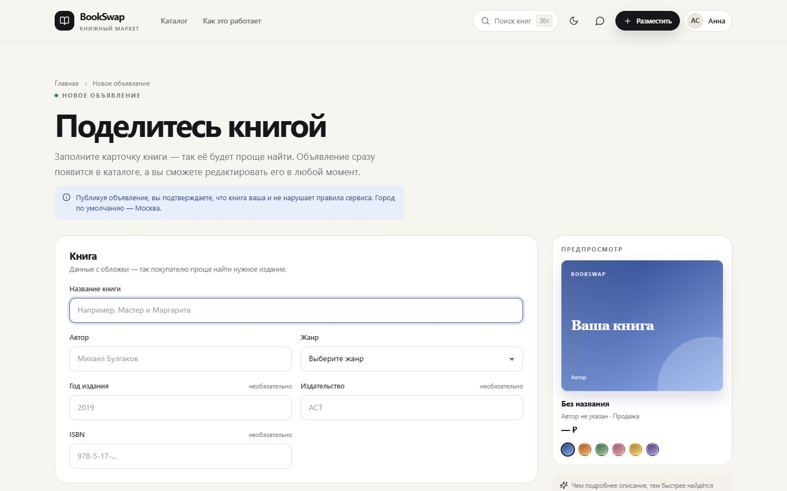
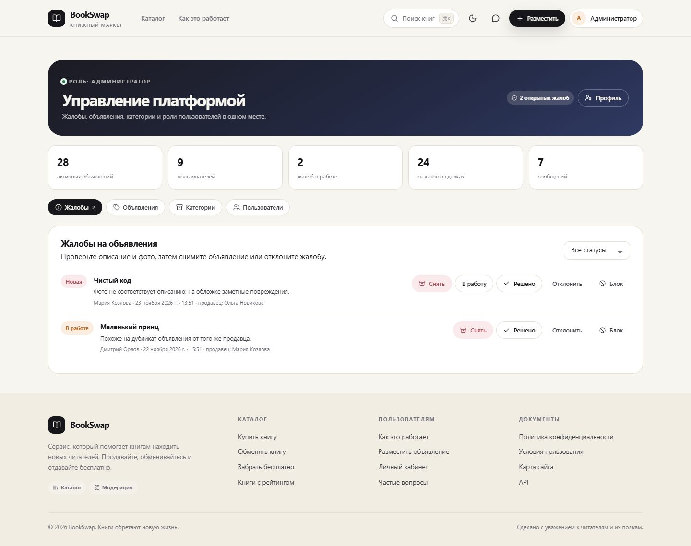
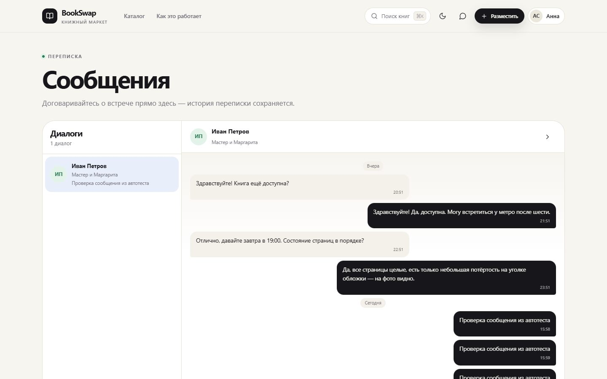

# BookSwap

Маркетплейс книг для обмена, продажи и бесплатной передачи книг между читателями.
React + Vite на фронтенде, Node.js/Express + PostgreSQL на бэкенде, полноценная SEO-разметка
и панель модерации.


## Что умеет

**Каталог и поиск**
- Полнотекстовый поиск по названию, автору, жанру и описанию, фильтры по типу, жанру, городу,
  состоянию и цене, сортировка по новизне, цене, рейтингу и популярности.
- Пагинация, фасеты с количеством объявлений, «похожие книги», сохранение параметров в URL
  (поиск можно отправить ссылкой).

**Объявления**
- Четырёх-шаговая публикация с предпросмотром обложки, загрузкой до трёх фотографий (JPEG/PNG/WebP
  до 5 МБ), выбором цвета обложки и проверкой полей.
- Редактирование, отметка «Книга передана», снятие с публикации и возврат в каталог.
- Объявления продавца, отзывы, рейтинги книг и продавцов.

**Аккаунты**
- Регистрация и вход по email/паролю (scrypt + JWT), редактирование профиля, аватар, «о себе».
- Избранное с живым состоянием сердечек, личный кабинет со статистикой.
- Встроенный чат: диалоги по объявлениям, история сообщений, непрочитанные, автообновление.

**Модерация**
- Роли `user`, `moderator`, `admin`; сервисные аккаунты входят только по специальной паре
  логин/пароль из окружения.
- Жалобы со статусами, снятие объявлений, блокировка пользователей, управление ролями,
  категории каталога, статистика платформы.

**SEO и доступность**
- Серверная подстановка `<title>`, description, canonical, Open Graph и JSON-LD для карточек
  книг и продавцов (работает для соцсетей и поисковых роботов).
- `sitemap.xml` (динамический, с инвалидацией кэша), `robots.txt`, корректные 404 и `noindex`
  для приватных разделов.
- Семантическая разметка, клавиатурная навигация, focus-trap в модальных окнах, `aria`-атрибуты,
  поддержка `prefers-reduced-motion`.

**Интерфейс**
- Светлая и тёмная темы (системная по умолчанию, переключатель в шапке), адаптив от 320 px,
  скелетоны загрузки, тосты, продуманные пустые состояния.

| Каталог | Карточка книги |
| --- | --- |
|  |  |

| Публикация объявления | Модерация |
| --- | --- |
|  |  |

| Сообщения | Мобильная версия |
| --- | --- |
|  |  |

## Быстрый старт

Нужен Node.js 20+. PostgreSQL для локального запуска **не требуется**: если `DATABASE_URL` не задан,
API поднимает встроенный PostgreSQL (PGlite, WebAssembly) в `.data/pglite` и наполняет его демо-данными.

```bash
npm install
npm run dev
```

- Приложение: http://localhost:5173
- API: http://localhost:4000/api
- Проверка здоровья: http://localhost:4000/api/health

Демо-аккаунты (пароль `demo12345`):

| Email | Роль |
| --- | --- |
| `anna@bookswap.local` | пользователь, 14 сделок |
| `ivan@bookswap.local` | пользователь, 9 сделок |
| `maria@bookswap.local` | пользователь, 6 сделок |

Служебные аккаунты — только по логинам из `.env` (`admin` / `moderator`). Значения по умолчанию:
`admin` / `admin-change-me` и `moderator` / `moderator-change-me`.

Чтобы начать с чистого каталога: `npm run seed:reset` (пересоздаёт демо-данные) или удалите `.data/`.

## Режим PostgreSQL

```bash
cp .env.example .env
# укажите DATABASE_URL и JWT_SECRET
npm run migrate
npm run seed        # опционально: демо-данные
npm run dev
```

После `npm run build` API сам раздаёт собранный фронтенд из `frontend/dist` — можно запускать
один сервис: `npm start`.

## Скрипты

| Скрипт | Действие |
| --- | --- |
| `npm run dev` | API и Vite одновременно |
| `npm run build` | production-сборка фронтенда |
| `npm start` | миграции (`prestart`) + API, раздача `frontend/dist` |
| `npm run migrate` | применить миграции |
| `npm run seed` | демо-данные (если база пуста) |
| `npm run seed:reset` | пересоздать демо-данные |
| `npm test` | 38 интеграционных тестов API |
| `npm run test --workspace backend` | то же самое напрямую |

## Структура

```
backend/
  migrations/            SQL-миграции (идемпотентные, с таблицей schema_migrations)
  src/
    app.js               сборка Express-приложения, статика, SEO, обработка ошибок
    bootstrap.js         подключение БД, миграции, демо-сид
    config/env.js        конфигурация из окружения
    db/                  драйверы pg / PGlite, мигратор
    lib/                 JWT, пароли, валидация, мапперы, ошибки, логи, пагинация
    middleware/          аутентификация, роли, безопасность, rate limit, ошибки
    repositories/        весь SQL
    routes/              HTTP-слой
    services/            бизнес-логика и права доступа
    seo/                 meta-теги, JSON-LD, sitemap, robots
    tests/               интеграционные тесты (node:test)
    scripts/             миграции и сиды
  uploads/               загруженные фотографии книг и аватары
frontend/
  public/                favicon, og-cover, тема, документы, robots
  src/
    components/          UI-компоненты (карточки, формы, модальные окна, фильтры)
    pages/               страницы и маршруты
    shared/              API-клиент, контексты, хуки, SEO, форматирование
    styles/              дизайн-токены, базовые стили, компоненты, страницы
docs/screenshots/        скриншоты для документации
```

## API

Все ответы — JSON, ошибки в формате `{ "error": "текст" }`. Авторизация: `Authorization: Bearer <JWT>`.

| Метод | Путь | Описание |
| --- | --- | --- |
| `GET` | `/api/health` | состояние сервиса и базы |
| `POST` | `/api/auth/register` `login` `logout` | регистрация, вход, выход |
| `GET/PATCH` | `/api/auth/me` | текущий пользователь, редактирование профиля |
| `GET` | `/api/users/:id` | публичный профиль продавца, отзывы, объявления |
| `GET` | `/api/listings` | каталог: поиск, фильтры, сортировка, пагинация |
| `GET` | `/api/listings/filters` | фасеты: жанры, города, состояния, цены, типы |
| `GET` | `/api/listings/mine` | свои объявления по статусу |
| `GET` | `/api/listings/:id` (+ `/similar`) | карточка книги и похожие |
| `POST/PATCH/DELETE` | `/api/listings/:id` | создание, редактирование, снятие |
| `PATCH` | `/api/listings/:id/status` | `active` / `sold` / `archived` |
| `GET/POST` | `/api/favorites[/:listingId]` | избранное |
| `GET` | `/api/books/best` | рейтинг книг |
| `GET/POST` | `/api/books/:id/ratings` | отзывы и оценки книги |
| `GET/POST` | `/api/chats[/:id/messages]` | диалоги и сообщения |
| `GET` | `/api/chats/unread-count` | счётчик непрочитанных |
| `POST` | `/api/moderation/reports` | жалоба на объявление |
| `GET/POST` | `/api/moderation/reviews` | отзывы о продавцах |
| `GET` | `/api/moderation/categories` | категории каталога |
| `GET/PATCH/DELETE` | `/api/moderation/*` | панель модерации (роли) |
| `POST` | `/api/uploads/image` | загрузка фото (multipart, ≤5 МБ) |
| `GET` | `/sitemap.xml`, `/robots.txt` | SEO |

Подробности слоёв и модели данных — в [ARCHITECTURE.md](./ARCHITECTURE.md).
Инструкция по деплою — в [DEPLOYMENT.md](./DEPLOYMENT.md).

## Тесты

```bash
npm test
```

38 интеграционных тестов поднимают приложение на встроенной PGlite, наполняют её демо-данными
и проверяют аутентификацию, права доступа, каталог и фильтры, жизненный цикл объявления,
избранное, оценки, чат, жалобы, отзывы и панель модерации.

## Известные ограничения

- Чат обновляется опросом (5 с в открытом диалоге, 30 с для счётчика) — без WebSocket.
- Загруженные файлы лежат на диске инстанса: на Render без постоянного диска они теряются при
  редеплое. Для полноценного хостинга подключите S3-совместимое хранилище.
- Нет подтверждения email, восстановления пароля и платежей: оплата и передача книги происходят
  между пользователями напрямую.
- Один инстанс API: rate limit и кэш sitemap хранятся в памяти процесса.

## Лицензия

Учебный проект. Сторонние библиотеки распространяются по своим лицензиям.
